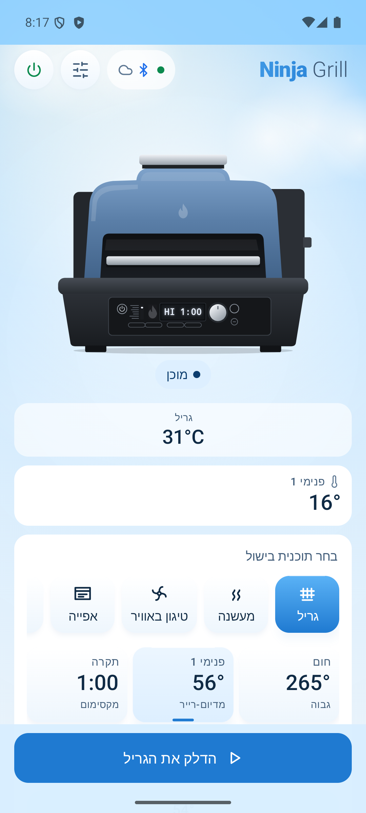
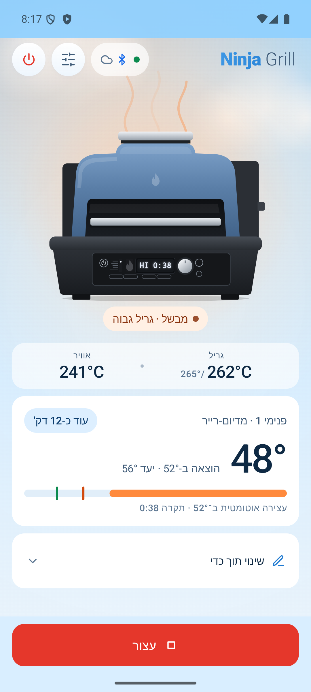
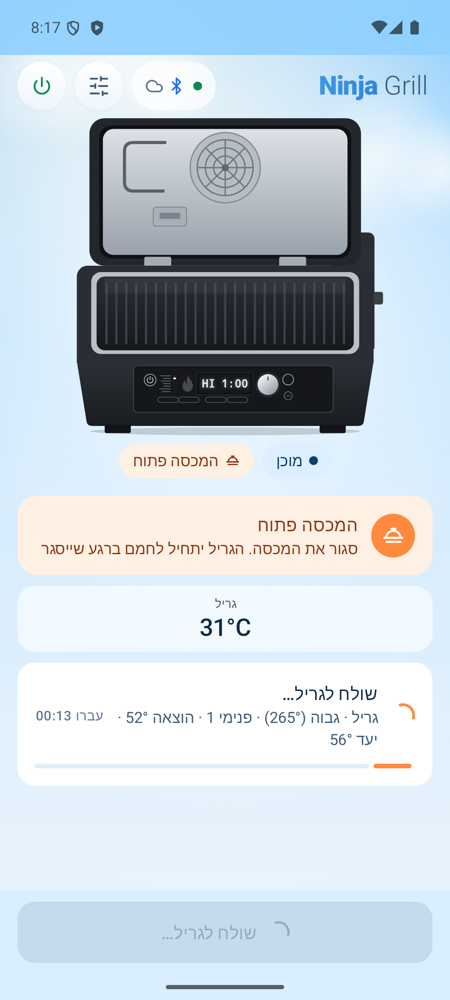
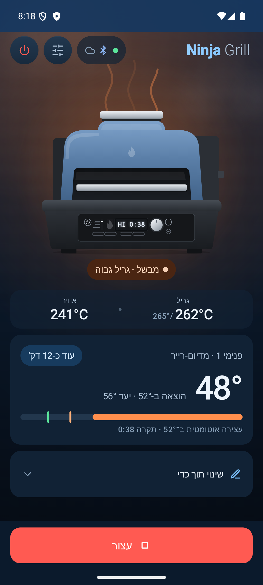

# Ninja Grill

**אפליקציית אנדרואיד לא רשמית לגריל Ninja Woodfire Pro Connect XL (OG901)**: שליטה וניטור דרך הענן של Ninja ו/או Bluetooth, בישול לפי מדחום עם עצירה אוטומטית, ותמיכה במדחומים האלחוטיים Tempwise.

*An unofficial Android app (Hebrew UI) for the Ninja Woodfire Pro Connect XL grill (OG901 / OG900-EU): cloud and Bluetooth control, probe-driven cooks that stop the grill at the pull temperature, and Tempwise TNT-2BW wireless probes.*

> לא קשור ל-SharkNinja ולא מאושר על ידה. Ninja ו-Woodfire הם סימנים מסחריים של בעליהם. זה גריל עם אש: הישארו בסביבה, והשתמשו באחריותכם.

<p align="center">
  
  
  
  
</p>

## מה היא עושה

- **מצב הגריל בזמן אמת**: שלב (הצתה, חימום מוקדם, בישול), טמפרטורת הגריל, האוויר ותא העישון, זמן שנותר ומה שהגריל מבקש ("הוסף אוכל", "הפוך").
- **בישול לפי מדחום**: בוחרים מידת עשייה, והאפליקציה עוצרת את הגריל בטמפרטורת ההוצאה (היעד פחות העלייה שבזמן המנוחה, שאתם מגדירים).
- **כל התוכניות**: גריל, מעשנה, טיגון באוויר, צלייה, אפייה, ייבוש וחימום, עם Woodfire, ודילוג על חימום מוקדם או על הצתה.
- **שינוי תוך כדי בישול**: טמפרטורה, זמן, מדחום ואפילו תוכנית.
- **אזהרות ברורות**: מכסה פתוח שמעכב התחלה, גריל שלא עונה (עם מה לבדוק ואפשרות ביטול), התראות לטלפון גם כשהאפליקציה סגורה.
- **מדחומי Tempwise TNT-2BW** (לא חובה): שני פרובים אלחוטיים, קריאה כל שנייה, יכולים לעצור את הגריל בדיוק כמו הפרובים של Ninja.
- **עובדת לצד האפליקציה הרשמית**: אפשר להשאיר את שתיהן מותקנות ופתוחות. גם אפליקציית המדחום (FitFlavor) יכולה להישאר פתוחה.
- עברית מלאה, מצב בהיר וכהה.

## מה צריך

1. גריל **Ninja Woodfire Pro Connect XL ‏(OG901)**, מחובר ל-Wi-Fi דרך **האפליקציה הרשמית של Ninja**. דגמים אחרים לא נבדקו.
2. **חשבון Ninja**. האפליקציה הרשמית לא זמינה ב-Google Play בישראל, ולכן מתקינים אותה כקובץ APK.
3. טלפון אנדרואיד 8 ומעלה.

## התקנה

1. מורידים את קובץ ה-APK האחרון מ-[Releases](../../releases/latest).
2. פותחים אותו בטלפון ומאשרים "התקנה ממקורות לא ידועים". Play Protect עשוי להזהיר על אפליקציה שלא מ-Google Play, וזה צפוי.
3. פותחים את Ninja Grill ובוחרים דרך חיבור.

גרסאות חדשות מותקנות מעל הקודמת ושומרות את ההתחברות ואת ההגדרות.

## חיבור לגריל: שתי דרכים

| | חשבון Ninja (ענן) | Bluetooth |
|---|---|---|
| **מה צריך** | האימייל והסיסמה של אפליקציית Ninja | מפתח Bluetooth חד-פעמי מהעותק שלכם של אפליקציית Ninja |
| **איפה עובד** | מכל מקום עם אינטרנט | ליד הגריל, בלי אינטרנט |
| **מהירות** | עדכון כל ~10 שניות | מיידי |
| **הקמה** | דקה | ~15 דקות, עם מחשב |

**ההמלצה: מתחילים מהחשבון.** אפשר להוסיף Bluetooth אחר כך, ואז האפליקציה משתמשת בשניהם (מצב "אוטומטי": Bluetooth כשהגריל בטווח, ענן כשלא).

### א. חשבון Ninja
במסך הפתיחה מזינים את האימייל והסיסמה של אפליקציית Ninja. הסיסמה נשלחת רק לשרת ההתחברות של Ninja ולא נשמרת בטלפון. נשמר רק אסימון התחברות, מוצפן ב-Android Keystore.

### ב. Bluetooth (מתקדם)
הגריל מצפין את התקשורת במפתחות שנגזרים מהספרייה שבתוך האפליקציה הרשמית ומכתובת ה-Bluetooth של הגריל. המפתחות לא מופיעים באף מקום ציבורי, ולכן מוציאים אותם פעם אחת **מהעותק שלכם**:

1. במחשב: מורידים את [coxtor/ninja-woodfire-integration](https://github.com/coxtor/ninja-woodfire-integration) ומתקינים `pip install unicorn capstone cryptography bleak`.
2. מעתיקים מהטלפון את ה-APK של אפליקציית Ninja (‏`adb shell pm path com.sharkninja.ninja.connected.kitchen`, ואז `adb pull`).
3. מריצים את `scripts/extract_ninja_keys.py` מהפרויקט ההוא על ה-APK, עם כתובת ה-MAC של הגריל (הכלי יודע גם לסרוק אותה). יוצא "key bundle" של 144 בתים.
4. באפליקציה: **הגדרות ← מפתח Bluetooth**, מדביקים את המפתח ואת כתובת הגריל.

> הגריל מקבל חיבור Bluetooth אחד בכל רגע. Ninja Grill קוראת את השידור הפתוח של הגריל בלי להתחבר, ומתחברת רק לרגע כדי לשלוח פקודה. לכן האפליקציה הרשמית ממשיכה לעבוד כרגיל.

## מדחומי Tempwise (לא חובה)

**הגדרות ← מדחום חיצוני ← חיפוש מדחום.** הבסיס TNT-2BW לא דורש צימוד או חשבון. האפליקציה קוראת את שני הפרובים כל שנייה, גם כשאפליקציית FitFlavor פתוחה, כי שתיהן חולקות את אותו חיבור. אם הצבעים יוצאים הפוכים, בהגדרות יש "החלף צבעים". שום פקודה לא נשלחת לבסיס.

## פרטיות ובטיחות

- אין אנליטיקה ואין שרת משלנו. האפליקציה מדברת רק עם הגריל ועם השרתים של Ninja.
- האסימון והמפתח מוצפנים ב-Android Keystore.
- פקודות לגריל יוצאות רק כשלוחצים, או כשמגיעים לטמפרטורת ההוצאה בבישול לפי מדחום שהגדרתם.
- עצירה ידנית תמיד זמינה, וגם הכפתורים על הגריל עצמו ממשיכים לעבוד.

## בנייה מהקוד

דרישות: Android Studio (JDK 21 שמגיע איתו), Android SDK 37.

```powershell
copy secrets.properties.example secrets.properties   # ממלאים לפי _lib/const.py ב-coxtor (אזור EU)
$env:JAVA_HOME = 'C:\Program Files\Android\Android Studio\jbr'
.\gradlew.bat assembleDebug testDebugUnitTest
```

- `secrets.properties` מחזיק את המזהים הציבוריים שהאפליקציה הרשמית שולחת לשרתים של Ninja. הוא לא נכנס ל-git.
- `.secrets/` (לא נכנס ל-git) יכול להחזיק את `key_bundle.txt` שלכם ואת `captures_private.json`. בלעדיהם הבדיקות שצריכות מפתח פשוט מדולגות. שם גם מפתח החתימה של גרסת ה-release ‏(`keystore.properties` ו-`release.jks`). בלעדיו `assembleRelease` נחתם במפתח ה-debug המקומי.
- תמונות הגריל באפליקציה הן ציור וקטורי שלנו. בבנייה מקומית אפשר לשים תמונות משלכם ב-`app/src/debug/res/drawable-nodpi/grill_closed.png` ו-`grill_open.png`, והן לא נכנסות ל-git.
- **מצב הדגמה** (debug בלבד), להסתכל על כל המסכים בלי גריל:
  `adb shell am start -n com.example.mygrill/.MainActivity --es demo idle|preheat|cooking|timer|done|off|starting|lid --es theme light|dark`
- **התקנה אישית**: ‏`tools\install-mine.ps1 -Device <serial>` בונה, מתקין על טלפון אחד וטוען את המפתח מ-`.secrets`.

### מבנה

```
app/src/main/java/com/example/mygrill/
  core/   פרוטוקולים טהורים ונבדקים: beacon, פריימים של GATT, ענן, מיזוג ערוצים, Tempwise, אירועי בישול
  data/   ערוצים: CloudClient (Auth0 + AWS), BeaconScanner, GattCommandLink, TempwiseLink,
          GrillRepository (מצב אחד לכל האפליקציה), MonitorService (מעקב ברקע), Notifier
  ui/     Compose: מסך הבית, מתכנן הבישול, הגדרות, מסך פתיחה; theme/ לצבעים
```

`DESIGN.md` מתאר את שפת העיצוב ו-`PRODUCT.md` את המוצר.

## תודות

הפרוטוקול (ענן, beacon ו-GATT) מבוסס על [coxtor/ninja-woodfire-integration](https://github.com/coxtor/ninja-woodfire-integration) ‏(MIT) ונבדק מול OG901 אמיתי. פענוח מדחום ה-Tempwise נעשה בפרויקט הזה.

## רישיון

[MIT](LICENSE). מותר להשתמש, לשנות ולהפיץ, כולל ההודעה של הפרויקט של coxtor שעליו הפרוטוקול מבוסס.
